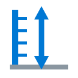
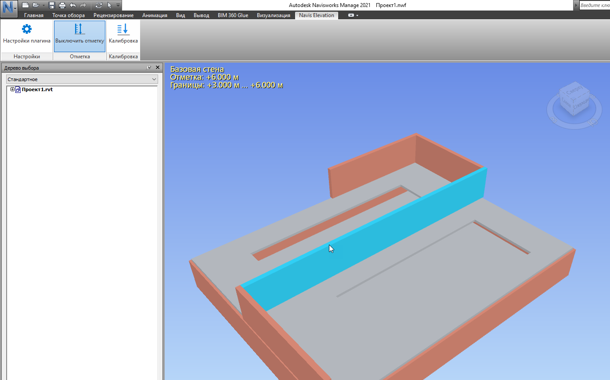

<p align="center">
  
</p>

<h1 align="center">Navis Elevation</h1>

<p align="center">
  <b>Плагин для Autodesk Navisworks Manage 2021: показывает отметку (высоту) элемента модели прямо при наведении курсора в 3D-виде.</b>
</p>

<p align="center">
  <a href="https://github.com/temapromaster3000/new-navis/releases"></a>
  <a href="https://github.com/temapromaster3000/new-navis/releases"></a>
  
  
  <a href="LICENSE"></a>
</p>

---

## 📸 Как это выглядит



Вкладка **Navis Elevation** на ленте, нажатая кнопка «Выключить отметку» и подпись
в левом верхнем углу вида: отметка элемента, его границы по высоте и имя элемента.

## 💡 Зачем

В Navisworks нет встроенной функции показа отметки элемента. Когда модель большая
и смотреть её в разрезе с подписями неудобно, приходится либо открывать исходный
файл в Revit, либо гадать по уровням. Плагин снимает эту рутину: **навёл курсор —
видишь высоту**.

## 🧰 Возможности

### 📏 Отметка под курсором

- Отметка точки под курсором **в метрах** — независимо от того, в каких единицах
  пришла модель: футы, дюймы или миллиметры переводятся автоматически.
- **Границы элемента по вертикали** (низ и верх) — сразу видно высоту самого элемента.
- Название элемента и имя файла модели-источника.
- Подсветка элемента под курсором.

Подпись рисуется в левом верхнем углу 3D-вида и не перекрывает модель:

```
Балка / Beam 250x500
Отметка: +3.000 м
```

### 🎯 Калибровка отметки

В API Navisworks нет базовой точки проекта, поэтому «правильность» отметки нельзя
проверить заранее — она сверяется вручную с элементом заведомо известной отметки.
Отметка всегда переводится в метры, независимо от единиц модели.

Если элемент с заведомо известной проектной отметкой `+12.000` показан как `9.640`,
разница `2.360` — это ноль проекта. Сдвинуть отметки можно кнопкой **«Калибровка»**
на вкладке Navis Elevation:

1. Нажмите «Калибровка» — откроется окно со статусом и двумя действиями.
2. «Установить новую калибровку» — в 3D-виде появится надпись «Выберите точку
   калибровки» и текущая отметка под курсором.
3. Кликните по элементу, проектная отметка которого известна (например, верх
   перекрытия).
4. В окне введите его проектную отметку в метрах — плагин сам посчитает сдвиг и
   применит его ко всем отметкам модели.

После калибровки в подписи появляются строки «Отметка откалибрована» и «Смещение» —
всегда видно, что число сдвинуто. Кнопка «Сбросить калибровку» в том же окне
возвращает отметки к нулю модели.

Калибровка хранится отдельно для каждой модели в
`%APPDATA%\NavisElevation\offsets.ini` и **не попадает внутрь файла модели**: коллега
откалибрует у себя сам. На рабочих моделях ноль Navisworks совпал с проектным, и
калибровка не требовалась.

### ⚙️ Настройки

Кнопка «Настройки плагина» открывает окно поверх Navisworks: версия плагина и
краткое описание работы. Оттуда же запускается проверка обновлений.

### ⬇️ Проверка обновлений

Плагин спрашивает у GitHub, не вышла ли новая версия, и может её скачать и поставить:

1. В окне настроек нажмите **«Проверить обновления»**. Если новой версии нет, плагин
   честно так и скажет.
2. Если релиз есть, показываются его примечания и кнопка «Скачать и установить».
3. Скачивание идёт с прогрессом и не мешает работать в Navisworks.
4. Перед подменой файлов плагин спрашивает подтверждение. Сама подмена происходит
   после закрытия Navisworks — отдельной программой, потому что файлы плагина
   заняты, пока Navisworks открыт.

Если обновление скачано, а Navisworks закрыть не удалось, кнопка в окне настроек
останется — нажмите её позже, и обновление применится при следующем выходе из
Navisworks.

Плагин ходит в сеть **только по нажатию кнопки**. Разбор ответа GitHub сделан на
`System.Web.Extensions` из самого .NET Framework: никаких дополнительных библиотек
рядом с плагином не появляется, а такие библиотеки Navisworks может не подхватить.

## 📦 Установка

**Способ 1 — установщик (рекомендуется):** скачайте
[`NavisElevation-1.0.0-setup.exe`](https://github.com/temapromaster3000/new-navis/releases)
со страницы [Releases](https://github.com/temapromaster3000/new-navis/releases) и
запустите. Прав администратора не нужно.

Установщик кладёт плагин в
`%APPDATA%\Autodesk\ApplicationPlugins\NavisElevation.bundle\`: описание бандла
`PackageContents.xml` плюс `NavisElevation.dll` в `Contents\2021\`. Бандл, а не просто
DLL, потому что Navisworks 2021 читает плагины из папки `Plugins` внутри своей папки
установки, а писать туда можно только с правами администратора.

**Полностью закройте Navisworks и запустите заново:** бандлы читаются только при
старте. DLL Navisworks подгружает сам, копировать их вручную не нужно.

**Способ 2 — из исходников:** `build-and-deploy.bat` в корне репозитория. Скрипт
соберёт плагин и обновлятель, разложит бандл в `%APPDATA%` и положит туда же
программу-обновлятель.

## ▶️ Как пользоваться

1. Откройте модель.
2. Найдите вкладку **Navis Elevation** на ленте Navisworks и нажмите «Показать отметку».
3. Наведите курсор на элемент — в левом верхнем углу вида появится подпись с отметкой,
   а сам элемент подсветится.
4. `Esc`, правая кнопка мыши или повторное нажатие кнопки выключают режим.

> Во встроенной вкладке Add-Ins кнопок плагина нет: весь интерфейс живёт на собственной
> вкладке **Navis Elevation**.

## 📋 Требования

- Autodesk Navisworks Manage 2021 (64-бит).
- Windows 10/11 x64.
- .NET Framework 4.8 — входит в состав Windows, отдельно ставить не нужно.
- [.NET SDK](https://dotnet.microsoft.com/download) — только для сборки из исходников.

## 🛠 Сборка из исходников

```powershell
dotnet build build\NavisElevation.sln -c Debug
```

Если Navisworks установлен не в `C:\Program Files\Autodesk\Navisworks Manage 2021`:

```powershell
dotnet build build\NavisElevation.sln -c Debug -p:NavisworksInstallDir="D:\Autodesk\Navisworks Manage 2021"
```

Ссылка на API Navisworks — только `<Reference>` с путём к DLL в папке установки:
NuGet-пакета `Navisworks.Api` не существует. Сборка идёт под `net48` — Navisworks
2021 работает как хост на .NET Framework 4.8.

## 📤 Выпуск релиза

```powershell
tools\release.bat
```

Скрипт собирает плагин и обновлятель, собирает архив обновления
`NavisElevation-2021.zip`, компилирует установщик `NavisElevation-<версия>-setup.exe`
через [Inno Setup 6](https://jrsoftware.org/isinfo.php) и публикует всё это на GitHub
как релиз через [GitHub CLI](https://cli.github.com/) с авторизацией.

С ключом `-DryRun` скрипт только покажет, что уйдёт на GitHub, ничего не публикуя.
Номер версии хранится в `Version.txt` в корне репозитория.

## 🩺 Диагностика

Плагин пишет `%LOCALAPPDATA%\NavisElevation\plugin.log` — файл создаётся в момент
загрузки сборки, а не по нажатию кнопки. По нему видно, загрузил ли Navisworks плагин,
нажата ли кнопка и нашёлся ли элемент под курсором.

Отсутствие вкладки **Navis Elevation** означает, что плагин не загрузился: вкладка
создаётся только при успешной загрузке. Присылайте лог — по нему причина определяется
однозначно.

Программа-обновлятель пишет свой журнал в `%APPDATA%\NavisElevation\updater-log.txt`:
в нём видно, дождалась ли она закрытия Navisworks и какие файлы подменила.

## 🗂 Структура проекта

```
new-navis
├── src/
│   ├── NavisElevation.Core/        # Логика без Navisworks: версии, отметки, настройки
│   ├── NavisElevation.Navis/       # Код, требующий Navisworks API: лента, инструмент, UI
│   └── NavisElevation.Updater/     # Консольная программа: подмена файлов после выхода
├── build/NavisElevation.sln        # Решение Visual Studio
├── deploy/                         # Описание бандла для Navisworks
├── docs/                           # Планы фич (realized / in-progress / future)
├── tools/                          # Иконки, установщик, релизный конвейер
├── build-and-deploy.bat            # Сборка и установка в Navisworks
└── Version.txt                     # Версия плагина (единый источник)
```

## 📄 Лицензия

[MIT](LICENSE) — свободное использование, копирование и изменение с сохранением
указания авторства.
